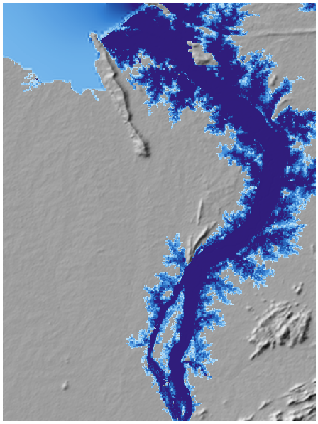
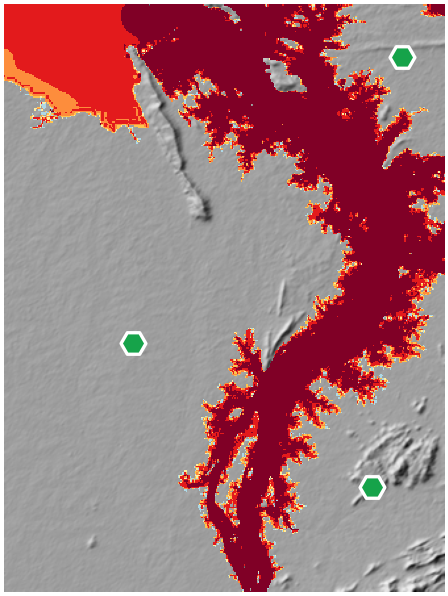
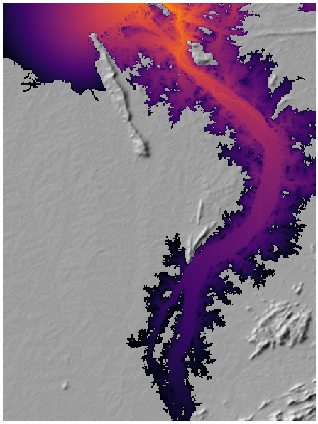
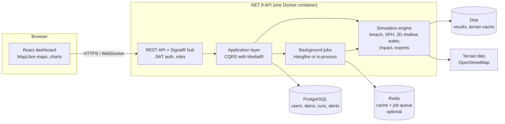

# PralayDrishti

**Dam-break and glacial-lake flood decision support for India.**
Pick a dam (or outline a landslide lake on a satellite image), simulate its failure, and get a flood map, the list of
villages that flood and when, the time people have to get out, and ready-to-send alerts and reports.

> *Pralay* (प्रलय) = deluge, *Drishti* (दृष्टि) = sight: seeing the flood before it happens.

**Live demo:** https://sihproject-latest.onrender.com
Use the one-click demo accounts on the login page (Admin / Analyst / Viewer).
The demo runs on a free server, so the first load can take about a minute to wake up.



---

## Contents

- [The problem](#the-problem)
- [Our solution](#our-solution)
- [How it works](#how-it-works)
- [Using the website](#using-the-website)
- [Architecture](#architecture)
- [Tech stack](#tech-stack)
- [Run it locally](#run-it-locally)
- [Deployment](#deployment)
- [Validation](#validation)
- [Project structure](#project-structure)
- [Limitations](#limitations)

---

## The problem

India has thousands of large dams and a growing number of unstable glacial and landslide-dammed lakes in the Himalaya.
When one fails, the people downstream have minutes to hours:

- **Chamoli / Rishi Ganga, February 2021** - a rock-ice avalanche and flood destroyed two hydropower projects.
- **South Lhonak Lake, Sikkim, October 2023** - a glacial lake outburst destroyed the Teesta-III dam downstream.
- **Parechu, 2004** - a landslide lake across the border in Tibet threatened the Sutlej valley.

In each case the same questions had to be answered fast, and mostly were not:

1. **Where will the water go, and how deep?**
2. **When does it reach each village?**
3. **Who has to move, which bridges and roads will be cut, and where can relief be staged?**
4. **How do we tell people in time?**

Detailed dam-break studies exist, but they take specialists days with expensive software and are done for one dam at a
time. District officials, NDRF and the Army need an answer in minutes, for any dam, including lakes that formed last week.

## Our solution

PralayDrishti is a web application that turns "this dam / this lake might fail" into an evacuation map in a few minutes:

| | |
|---|---|
| **Any dam, not one valley** | A register of Indian dams, a custom dam placed by clicking the map, or a natural dam drawn on satellite imagery. |
| **Physics, not guesswork** | A breach model, a particle (SPH) model near the dam and a 2D shallow-water model for the river reach. |
| **Answers people can act on** | People at risk, arrival time per village, "golden time" to evacuate, bridges overtopped, roads cut, relief staging areas and helipads, indicative loss. |
| **Automatic for new lakes** | A satellite detection of a new lake goes through volume estimate, simulation and alert with no manual step. |
| **Ready to send** | One-page PDF situation report, CAP 1.2 alerts (English + Hindi), Shapefiles, Google Earth, GeoJSON, WMS. |
| **Shows its working** | A validation page comparing the model with exact solutions and benchmarks. |

## How it works

```
 1 Input            2 Terrain           3 Breach            4 Flood model              5 Impact              6 Output
 ───────────        ─────────────       ───────────────     ──────────────────────     ─────────────────     ──────────────
 Dam from the  ──▶  Elevation     ──▶   How the dam    ──▶  4a SPH near the dam   ──▶  Villages, bridges ──▶ Live map
 register,          model, river        opens and the       (violent flow, impact      roads, hospitals,     PDF sitrep
 custom dam, or     tracing, lake       outflow over        forces)                    arrival time,         CAP alert
 drawn landslide    volume curve        time                4b 2D shallow water        golden time,          SHP / KMZ /
 debris                                 (hydrograph)        20-100 km downstream       staging, loss         GeoJSON / WMS
```

1. **Input** - a dam from the register, a custom dam, or a debris outline drawn across a valley.
2. **Terrain** - elevation data (uploaded DEM, or SRTM-based terrain tiles) is fetched, the river is traced downstream
   and, for natural lakes, the lake's level-area-volume curve is computed.
3. **Breach** - empirical breach models (Froehlich 2008, MacDonald & Langridge-Monopolis, Costa & Schuster for
   landslide dams) give the breach size, formation time and the outflow hydrograph.
4. **Flood model** - a hybrid:
   - **SPH (smoothed-particle hydrodynamics)** for the first few kilometres, where the flow is violent and carries
     debris, and where the impact force on a downstream structure matters.
   - **2D shallow-water equations** (HLL solver) for the long river reach, optionally cascading into downstream dams.
     Delft3D FM can be used instead when installed.
5. **Impact** - the flood is overlaid on settlements, bridges, roads and facilities (OpenStreetMap plus uploaded data)
   to get hazard classes (depth × velocity), arrival and peak times, people at risk, golden time, loss, relief staging
   areas and early-warning sensor sites. An optional **ensemble** of runs gives a probability-of-flooding map.
6. **Output** - an interactive map with a time animation, and exports for the people who have to act.

| Hazard classes | Arrival time | Near-field SPH |
|---|---|---|
|  |  |  |

### Lake-to-alert, automatically

Glacial and landslide lakes appear between surveys. PralayDrishti accepts lake detections from a satellite scan
(Sentinel-1/2 water index) at `POST /api/lakes/detections` or as before/after NDWI GeoTIFFs. For each new lake it
estimates the volume from terrain, simulates the outburst and raises an alert with the affected villages - from
satellite pixel to evacuation map without anyone pressing a button.

## Using the website

Sign in (or use a demo account). There are three roles:

| Role | Can do |
|---|---|
| **Viewer** | See everything, change nothing. New sign-ups start here. |
| **Analyst** | Run simulations, upload data, raise alerts. |
| **Admin** | Everything, plus manage users and the dam register. |

The sidebar follows the order you would work in:

**Simulate**

- **Dam break** - search or filter the dam register, or click a dam on the map. The form is pre-filled (dam type,
  failure mode, height, volume). Press **Run simulation**. *Quick demo* switches to settings that finish in a few
  minutes on a small server. *Custom dam* lets you place a dam anywhere.
- **Natural dams & lakes** - draw the landslide debris on satellite imagery to estimate the lake and simulate its
  outburst, or estimate the volume of a reservoir that can only be seen from space.
- **Results** - every run, with live progress. Opening a run shows:
  - the flood on the map, with layers for **depth, hazard, arrival time, velocity** and (for ensembles) probability,
    and a time slider that plays the flood moving downstream;
  - headline figures: people at risk, when the water first arrives, settlements hit, flooded area, peak outflow, loss;
  - **Impact** - each village with arrival time, depth, hazard and golden time; bridges; roads cut; staging areas;
  - **Hydraulics**, **SPH** and **Ensemble** details for specialists;
  - **Export** - PDF sitrep, Shapefiles, KMZ, GeoJSON, CSV, CAP alert, and model files for Delft3D / DualSPHysics.
  - Clicking any point on the map gives depth, speed and arrival time there.

**Respond**

- **Lake watch & alerts** - detected lakes, their simulations and the alerts raised; inject a detection for a demo.
- **Threshold queries** - work backwards: *how much release floods this bridge?* or *the satellite shows this flood,
  how much was released upstream?*
- **Risk atlas** - run every dam in the register and rank them by people at risk.

**Evidence**

- **Validation** - model vs exact solutions, a historical benchmark, and real floods seen by satellite.
- **Data & system** - upload terrain (DEM) and exposure data, manage the dam register.
- **Users** (Admin) - roles and access.

A typical demo: sign in as Analyst → Dam break → pick **Hirakud** → Run simulation → watch the flood animation →
Impact tab → Export the PDF sitrep and raise an exercise alert.

## Architecture



- **Clean architecture** in the backend: `Domain` → `Application` (commands, queries, validation) →
  `Infrastructure` (database, engine, exports) → `API` (controllers, SignalR, auth).
- Simulations run as **background jobs**; progress is pushed to the browser over SignalR.
- **Redis is optional.** Without it the API uses an in-memory cache and runs jobs in-process.
- The built dashboard is served by the API, so the whole app is **one container and one URL**.

## Tech stack

| Layer | Technology |
|---|---|
| Solvers | 2D shallow-water (HLL, hydrostatic reconstruction) and WCSPH, written in C#; Delft3D FM and DualSPHysics export |
| Backend | .NET 8, ASP.NET Core, MediatR (CQRS), FluentValidation, EF Core, Hangfire, SignalR, JWT |
| Data | PostgreSQL (Neon in production), Redis, NetTopologySuite, LibTiff, ImageSharp, QuestPDF |
| Frontend | React 18, TypeScript, Vite, MapLibre GL (3D terrain), Recharts |
| Geo data | SRTM-based terrain tiles or uploaded DEMs (Copernicus GLO-30, FABDEM, CartoDEM), OpenStreetMap |
| Deploy | Docker, Docker Hub, Render |

## Run it locally

### Option A - everything in Docker (easiest)

Needs only Docker Desktop.

```bash
docker compose up --build
```

Open http://localhost:8080 and sign in with a demo account (password `Demo@12345`).

### Option B - development mode

Needs .NET 8 SDK, Node 20+ and Docker (for Postgres and Redis).

```bash
docker compose -f docker-compose.dev.yml up -d
```

```bash
dotnet run --project backend/src/PralayDrishti.API --launch-profile http
```

```bash
npm --prefix frontend install
npm --prefix frontend run dev
```

Open http://localhost:5173. The API is on http://localhost:5080 (Swagger at `/swagger`).

If port 5432 is already used by a PostgreSQL installed on your machine, run the database container on another port and
set `ConnectionStrings__DefaultConnection` accordingly.

### Tests

```bash
dotnet test backend/PralayDrishti.sln
```

## Deployment

The backend and dashboard ship as one image: [`sahilbishnoi1/sihproject`](https://hub.docker.com/r/sahilbishnoi1/sihproject).
It is deployed on Render with a Neon PostgreSQL database. Step-by-step instructions, the environment variables and a
Render Blueprint are in **[docs/DEPLOYMENT.md](docs/DEPLOYMENT.md)**.

Secrets (database URL, JWT secret) are never stored in the repository - they are set as environment variables on the host.

## Validation

| Level | Test | Status |
|---|---|---|
| 1 | **Ritter** dam break on a dry bed (exact solution) | relative L1 error about 2.9% |
| 1 | **Stoker** dam break on a wet bed (exact solution) | relative L1 error about 0.7% |
| 1 | **SPH** front speed vs Ritter | compared live on the Validation page |
| 2 | **Malpasset 1959** benchmark | runner implemented; benchmark data is not bundled |
| 3 | Real flood vs Sentinel-1 extent (CSI, F1, POD, FAR) | comparison tool implemented; event data to be added |

The Validation page recomputes the Level 1 checks every time it is opened.

## Project structure

```
backend/
  src/
    PralayDrishti.Domain/          entities, enums
    PralayDrishti.Application/     commands, queries, validators, DTOs
    PralayDrishti.Infrastructure/  database, simulation engine, exports, background jobs
    PralayDrishti.API/             controllers, SignalR hub, auth, startup
  tests/                           unit tests and engine / integration tests
frontend/
  src/
    pages/                         one file per screen
    components/                    MapView, Workspace, charts, scenario options
    styles.css                     design system
data/
  seed/dams.json                   dam register seed
  exposure/                        demo exposure layer
docs/                              deployment guide, pitch slides
Dockerfile                         builds the single production image
docker-compose.yml                 production image + Postgres + Redis, locally
docker-compose.dev.yml             Postgres + Redis for development
render.yaml                        Render Blueprint
```

## Limitations

This is a hackathon prototype, meant for planning and exercises - not a certified warning system.

- Dam register values are approximate and should be verified against CWC / state records before use.
- Open elevation data has no river bathymetry and limited accuracy in narrow gorges; an uploaded high-resolution DEM
  improves results.
- Loss figures are indicative and use default unit costs.
- Population and settlement data come from OpenStreetMap, which is incomplete in remote areas.
- On the free demo server, simulations are slow and large runs may not finish; use *Quick demo* settings there.

In a real emergency, follow the instructions of the district disaster management authority.
